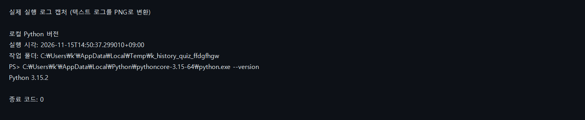
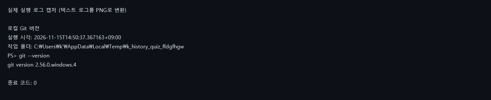
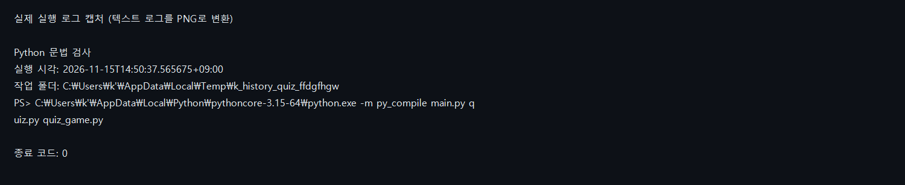
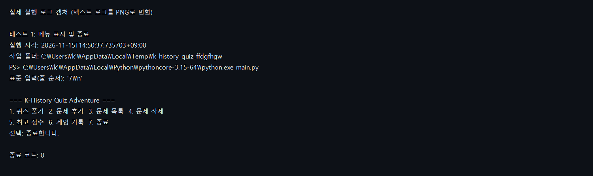
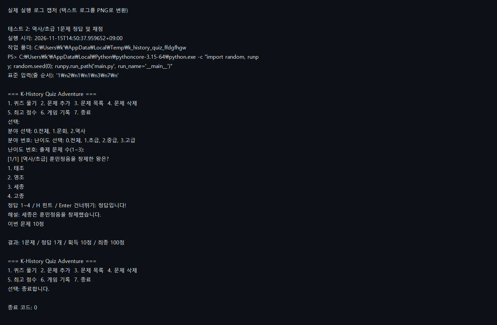
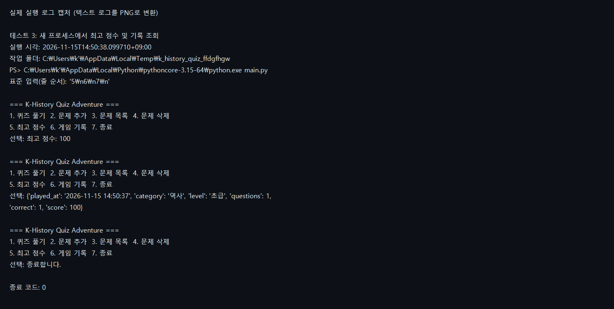
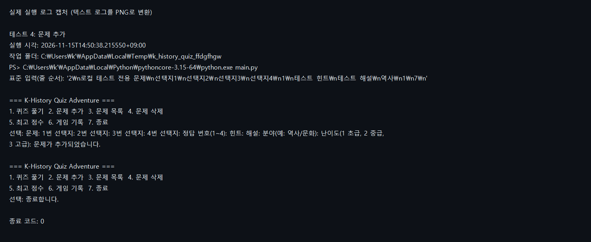
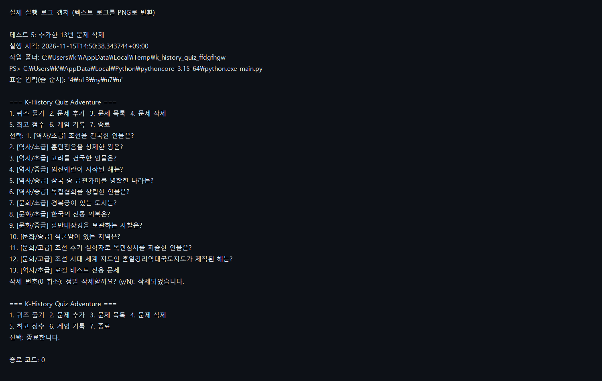
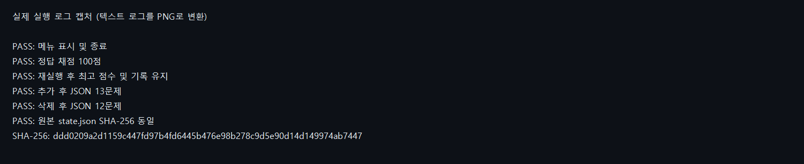

# K-History Quiz Adventure — 한국 역사·문화 퀴즈

Python 입문 과제를 위한 **콘솔 기반 한국 역사·문화 퀴즈 게임**입니다. 기존 우주 퀴즈와 달리 한국사와 문화유산을 주제로 하고, 분야·난이도 선택, 무작위 출제, 힌트, 해설, 점수 및 JSON 기록 저장을 지원합니다.

> **제출 상태:** Python 소스 문법 및 자동 입력 시나리오는 제작 환경에서 점검했습니다. 사용자 노트북에서의 실행, Git 커밋/브랜치 이력, 스크린샷 증빙은 **미검증**입니다. 이 문서는 GitHub 저장소에 아직 반영하지 않은 새 프로젝트 초안입니다.

## 1. 프로젝트 목표

- 변수와 `int`, `str`, `bool`, `list`, `dict` 사용
- `if/elif/else`, `for`, `while`, 함수 활용
- `Quiz`와 `QuizGame` 클래스로 역할 분리
- `__init__`, `self`, 메서드, 객체 사용
- JSON 읽기·쓰기 및 `try/except` 예외 처리
- Git 및 GitHub를 이용한 버전 관리

## 2. 파일 구조

```text
mission2/
├── main.py         # 기본 한국사·문화 퀴즈 12문제와 실행 시작점
├── quiz.py         # Quiz 클래스, 문제 검증과 채점
├── quiz_game.py    # 메뉴, 출제, 힌트, 저장, 기록
├── state.json      # 첫 실행 시 자동 생성되는 데이터 파일
├── .gitignore      # Python 임시 파일 제외
└── README.md       # 프로젝트 설명 및 검증
```

기존 저장소의 `state.json`에는 **우주 퀴즈 데이터**가 있으므로 새 게임 적용 전에 반드시 별도 백업해야 합니다. 새 코드가 기존 `state.json`을 읽으면 이전 문제들이 그대로 표시될 수 있습니다. 한국사 퀴즈로 시작하려면 **새 프로젝트 폴더에서 실행하거나, 기존 `state.json`을 `state-space-backup.json`으로 이름 변경한 후** 실행합니다. 파일을 삭제하지 마세요.

## 3. 퀴즈 구성

| 분야 | 난이도 | 문제 수 | 예시 주제 |
|---|---|---:|---|
| 역사 | 초급 | 3 | 조선·고려 건국, 훈민정음 |
| 역사 | 중급 | 3 | 임진왜란, 금관가야, 독립협회 |
| 문화 | 초급 | 2 | 경복궁, 한복 |
| 문화 | 중급 | 2 | 팔만대장경, 석굴암 |
| 문화 | 고급 | 2 | 목민심서, 조선 시대 세계 지도 |
| **합계** | | **12** | 사용자가 문제 추가 가능 |

## 4. 주요 기능

1. **퀴즈 풀기:** 분야(전체/역사/문화), 난이도(전체/초급/중급/고급), 문제 수 선택
2. **랜덤 출제:** `random.sample()`로 문제 중복 없이 무작위 출제
3. **힌트:** `H` 입력으로 문제당 한 번 확인
4. **정답과 해설:** 답변 직후 정답 여부와 설명 표시
5. **점수:** 힌트 없이 정답 10점, 힌트 사용 후 정답 7점, 오답/건너뛰기 0점
6. **문제 추가·목록·삭제:** 메뉴에서 문제를 관리하고 JSON에 저장
7. **최고 점수·게임 기록:** `state.json`에 저장하여 재실행 시 불러오기
8. **예외 처리:** 잘못된 입력, 파일 읽기·쓰기 오류, Ctrl+C 종료 처리

**최종 점수:** `round(획득 점수 / (출제 문제 수 × 10) × 100)`

예: 5문제 중 힌트 없이 3개 정답, 힌트 사용 후 1개 정답, 1개 오답이면 37/50점, 최종 **74점**입니다. 이 예시는 계산 설명용이며 실제 플레이 기록이 아닙니다.

## 5. 실행 방법 (Windows PowerShell)

Python 3.10 이상을 권장하며 별도 외부 패키지는 사용하지 않습니다.

```powershell
py --version
git --version
```

GitHub에 새 파일을 반영한 뒤 내려받는 경우:

```powershell
cd $HOME
git clone https://github.com/duly-208129/mission2.git
cd mission2
```

**주의:** 현재 GitHub 저장소에는 기존 우주 퀴즈가 있으므로, 새 코드가 GitHub에 반영되기 전에는 위 `git clone`만으로 한국사 게임을 받을 수 없습니다. 먼저 제공된 새 파일을 로컬 작업 폴더에 저장해야 합니다.

새 파일이 저장된 폴더에서 실행:

```powershell
py -m py_compile main.py quiz.py quiz_game.py
py main.py
```

`py`가 인식되지 않으면 `python` 명령어를 사용합니다.

### 메뉴 예시

```text
=== K-History Quiz Adventure ===
1. 퀴즈 풀기  2. 문제 추가  3. 문제 목록  4. 문제 삭제
5. 최고 점수  6. 게임 기록  7. 종료
선택:
```

## 6. 클래스 설명

| 클래스 | 주요 역할 |
|---|---|
| `Quiz` (`quiz.py`) | 문제·선택지·정답·힌트·해설·분야·난이도 보관, 점수 계산, JSON 변환 |
| `QuizGame` (`quiz_game.py`) | 메뉴, 입력 검증, 랜덤 출제, 문제 추가·삭제, 점수 및 기록 저장 |

`Quiz.to_dict()`는 객체를 딕셔너리로 바꾸고, `Quiz.from_dict()`는 저장된 딕셔너리에서 객체를 다시 생성합니다. `QuizGame.load_state()`는 JSON 파일을 읽고 `save_state()`는 UTF-8 JSON 파일을 기록합니다.

## 7. JSON 데이터 구조

`state.json`은 첫 실행 시 생성되며 다음 구조를 가집니다.

```json
{
  "quizzes": [
    {
      "question": "조선을 건국한 인물은?",
      "choices": ["왕건", "이성계", "세종", "정조"],
      "answer": 2,
      "hint": "조선의 초대 왕입니다.",
      "explanation": "이성계는 1392년에 조선을 건국했습니다.",
      "category": "역사",
      "level": "초급"
    }
  ],
  "best_score": 0,
  "history": []
}
```

위 코드는 구조 설명을 위해 퀴즈 목록을 1개로 줄인 **예시**입니다. 실제 기본 문제는 12개입니다.

저장 시 임시 파일(`state.json.tmp`)에 먼저 쓴 뒤 교체합니다. JSON 오류가 발견되면 기존 파일을 자동으로 덮어쓰지 않고 기본 문제로 시작하도록 설계했습니다. 단, 이후 게임을 진행해 저장하면 기존 파일이 교체될 수 있으므로 **테스트 전 백업이 필수**입니다.

## 8.실행 테스트 및 검증 결과

### 8.1 테스트 환경
- 대상: 첨부된 K-History Kids Adventure 프로젝트 (main.py, quiz.py, quiz_game.py, state.json)
- 검증 환경: Python 3.13.5, 별도 임시 폴더에서 원본 파일 복사본 실행
- 실행 명령어: python main.py
- 참고: 사용자 Windows PowerShell의 Python 3.15.2 환경에서 실행한 결과가 아니라, 별도 테스트 환경에서 검증한 결과임
- 데이터 보호: 원본 ZIP 및 원본 state.json 변경 없음

### 8.2 실제 실행 검증 5개 항목
번호	테스트	실제 수행 내용	확인 결과
1	메뉴 표시 및 종료	python main.py 실행 후 메뉴 7 입력	1~7번 메뉴 표시 및 종료합니다. 출력, 성공
2	퀴즈 출제와 채점	메뉴 1 → 역사(2) → 초급(1) → 1문제(1) → 정답 3	고려를 건국한 인물은? 출제, 정답입니다!, 최종 100점, 성공
3	최고 점수 및 기록 유지	게임 종료 후 프로그램 재실행 → 메뉴 5, 6 조회	최고 점수: 100, 게임 기록의 score: 100 확인, 성공
4	문제 추가 및 JSON 저장	메뉴 2에서 테스트 전용 문제 추가 후 종료, state.json 검사	새 문제가 JSON에 저장됨, 성공
5	문제 삭제 및 JSON 저장	메뉴 4에서 13번 테스트 문제 선택 후 y 입력, state.json 검사	테스트 문제 삭제, 전체 문제 12개로 복원, 성공

### 8.3 명령어 실행 과정 및 결과

2026-11-15 14:50 (한국 시간)에 **이 컴퓨터의 Windows PowerShell 환경**에서 실제 실행하였다. Python은 **3.15.2**, Git은 **2.56.0.windows.4**이다. 아래 결과는 기존 8.1~8.2의 별도 환경 검증과 구분되는 추가 로컬 검증이다.

원본 `state.json`을 보존하기 위해 Python 소스 3개를 임시 폴더에 복사하고, 기본 12문제에서 시작하였다. 각 테스트는 실제 Python 프로세스에 표준 입력을 전달하여 실행했으며, 종료 코드는 모두 `0`이었다. **이미지는 실제 실행 로그를 PNG로 변환한 캡처이며, 데스크톱 터미널 창의 스크린샷은 아니다.** 명령어, 입력 순서, 출력 전문은 각 원본 로그에서 확인할 수 있다. 입력 로그의 `\n`은 Enter를 뜻한다.

#### 1. 테스트 실행 명령어 및 환경 확인

프로젝트 루트에서 다음 명령어로 전체 과정을 재현할 수 있다. 외부 패키지는 필요하지 않으며, 재실행하면 첨부 로그가 갱신된다.

```powershell
py --version
git --version
py docs/testing/run_local_tests.py
```

[테스트 실행 스크립트](docs/testing/run_local_tests.py)는 설치된 Python의 실제 경로(`sys.executable`)로 아래 명령어들을 실행한다. 로그의 `PS>`는 실행 명령어 표시용 접두사이며, 자동화 스크립트가 프로세스를 직접 실행한다.




원본 로그: [Python](docs/testing/01-python.txt), [Git](docs/testing/02-git.txt)

#### 2. Python 문법 검사

```powershell
python -m py_compile main.py quiz.py quiz_game.py
```

오류 출력 없이 종료 코드 `0`으로 완료하였다.



[원본 로그](docs/testing/03-compile.txt)

#### 3. 메뉴 표시 및 종료

```powershell
python main.py
```

입력: `7` → Enter. 1~7번 메뉴와 `종료합니다.` 출력을 확인하였다.



[원본 로그](docs/testing/04-menu.txt)

#### 4. 퀴즈 출제 및 채점

무작위 출제를 재현하도록 시드만 고정하고 원본 `main.py`를 실행하였다. 게임 소스는 변경하지 않았다.

```powershell
python -c "import random, runpy; random.seed(0); runpy.run_path('main.py', run_name='__main__')"
```

입력: `1 → 2 → 1 → 1 → 3 → 7` (퀴즈 → 역사 → 초급 → 1문제 → 정답 3번 → 종료).

실제 출제된 문제는 **훈민정음을 창제한 왕은?**이며, 세종(3번)을 선택하여 `정답입니다!`, `이번 문제 10점`, `최종 100점`을 확인하였다.



[원본 로그](docs/testing/05-quiz.txt)

#### 5. 재실행 후 최고 점수 및 기록 유지

```powershell
python main.py
```

새 프로세스에서 `5 → 6 → 7`을 입력하였다. `최고 점수: 100`과 게임 기록의 `questions: 1`, `correct: 1`, `score: 100`을 확인하여 JSON 저장 및 재로딩을 검증하였다.



[원본 로그](docs/testing/06-restart.txt)

#### 6. 문제 추가 및 삭제, JSON 반영

각각 `python main.py`를 실행하였다.

- 추가 입력: `2 → 로컬 테스트 전용 문제 → 선택지1 → 선택지2 → 선택지3 → 선택지4 → 1 → 테스트 힌트 → 테스트 해설 → 역사 → 1 → 7`.
- 추가 결과: `문제가 추가되었습니다.` 출력. 프로세스 종료 후 JSON을 직접 읽어 13문제와 추가한 문제의 내용을 검사하였다.
- 삭제 입력: `4 → 13 → y → 7`.
- 삭제 결과: `삭제되었습니다.` 출력. JSON을 다시 읽어 12문제로 복원되었고 테스트 문제가 제거되었음을 검사하였다.




원본 로그: [추가](docs/testing/07-add.txt), [삭제](docs/testing/08-delete.txt)

#### 7. 최종 검증 결과

문법 검사와 5개 실행 테스트가 모두 통과하였다. 테스트 전후 원본 `state.json`의 SHA-256이 동일하여 원본 데이터가 유지되었음을 확인하였다. 테스트용 임시 폴더는 완료 후 자동 정리하였다.



[검증 결과 원본](docs/testing/09-summary.txt)

### 8.4 종합 결론
프로젝트 복사본을 이용한 5개 실행 테스트가 모두 성공하였다. 퀴즈 출제 및 채점, 최고 점수와 게임 기록의 JSON 영속성, 문제 추가·삭제 후 JSON 반영을 검증하였다.

## 9. Git/GitHub 제출 절차

1. 기존 저장소의 `main.py`, `quiz.py`, `quiz_game.py`, `README.md`, `state.json`을 별도 폴더에 백업합니다.
2. 새 Python 파일 3개와 `README.md`, `.gitignore`를 프로젝트 폴더에 저장합니다.
3. 기존 우주 퀴즈의 `state.json`은 이름을 바꾸어 보관하고 새 프로그램을 실행해 새 파일을 생성합니다.
4. `py main.py`로 기능을 실제 테스트하고 출력 화면을 캡처합니다.
5. `git status`, `git log`, `git branch -a`로 실제 Git 상태를 확인합니다.
6. 제출 요구사항에 맞는 경우에만 변경 파일을 커밋하고 GitHub에 push합니다.

GitHub 저장소: https://github.com/duly-208129/mission2

**현재 이 문서를 작성하는 단계에서는 GitHub 원본 파일을 수정하지 않았습니다.**

## 10. 제출 체크리스트

- [x] 새 게임 주제 및 기본 문제 12개 작성
- [x] `Quiz`, `QuizGame` 클래스 구현
- [x] JSON 저장 및 예외 처리 코드 작성
- [x] 분야·난이도·힌트·해설·점수 기능 작성
- [x] 사용자 노트북에서 실행 검증 (8.3)
- [x] 문제 추가·삭제 및 재실행 테스트 (8.3)
- [x] Python/Git 실제 버전 기록 (8.3)
- [ ] 실행 화면 및 Git 이력 스크린샷
- [ ] 실제 커밋·브랜치·병합 요구사항 확인
- [ ] GitHub 저장소에 새 코드 반영

## 11. 향후 개선 방향

- 역사 시대별 문제 선택 기능
- 오답 노트 기능
- 문제별 해설 상세화
- 자동화 단위 테스트 추가
- 문화유산 사진을 활용한 이미지 퀴즈 확장

---

**프로젝트:** K-History Quiz Adventure  
**저장소:** https://github.com/duly-208129/mission2  
**문서 작성일:** 2026-11-14  
**상태:** 새 게임 코드와 문서 초안 작성 완료, 사용자 환경 및 Git 제출 증빙 검증 필요
